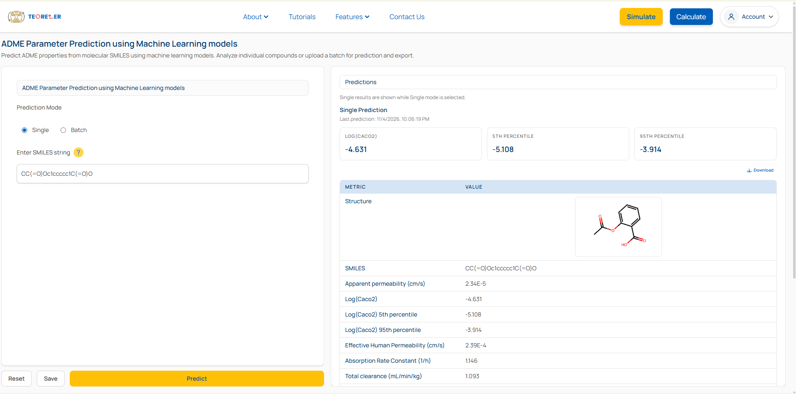

# FoEnet: A Fusion of Expert network for Machine Learning-Based Total Clearance Prediction of Chemical Compounds

## :bookmark_tabs: Table of Content

1. [Introduction](#introduction)
1. [Data Collection](#data-collection)
1. [Requirements](#requirements)
1. [Repository Outline](#repository-outline)
1. [Usages](#usages)
1. [Web-based Platform](#web-based-platform)
1. [References](#references)

## :book: Introduction
The Fusion-of-Expert network (FoEnet) integrates four complementary molecular information to predict the total clearnce value of chemical compounds.  These representations capture distinct aspects of molecular information, including molecular-level properties, substructure-level features, graph topology, and chemical language-based information. To extract these complementary representations, four corresponding computational approaches were employed, as summarised below.

| Information | Representation |
|---|---|
| Molecular-level | [Molecular descriptors](https://www.rdkit.org/) |
| Substructure-level | [Mol2Vec](https://github.com/samoturk/mol2vec/blob/master/examples/models/model_300dim.pkl) |
| Graph Topology| [Multi-relational Graph Neural Network](https://ascpt.onlinelibrary.wiley.com/doi/10.1002/psp4.70305) |
| Language-based | [Chemberta-2](https://huggingface.co/DeepChem/ChemBERTa-77M-MLM) |

## :dna: Data Collection

Six publicly available datasets were merged, and systematically filtered following the methods described in the `Data Collection` and `Data Preprocessing` sections in the main manuscript to construct the final dataset of 1763 chemical compounds. The data sources are summarised as follows:

| Dataset | # Collected Datapoints |  |
|---|---|---|
| Lombardo et al. (2018) | 1352 | [link](https://dmd.aspetjournals.org/cms/10.1124/dmd.118.082966/attachment/23162f03-5ccc-413e-acc2-453e45d435ae/mmc2-supplemental_82966_rev.xls) |
| Iwata et al. (2021) | 748 | [link](https://ars.els-cdn.com/content/image/1-s2.0-S0022354921000356-mmc2.pdf) |
| Iwata et al. (2022)| 741 | [link](https://ndownloader.figstatic.com/files/36746369) |
| Keefer et al. (2023)| 801 | [link](https://pubs.acs.org/mpohbp/article-supplement/312090/xlsx/mp3c00502_si_001/) |
| e-Drug3D (2024)| 1123 | [link](https://chemoinfo.ipmc.cnrs.fr/DOWNLOAD/MOLDB/e-Drug3D_2197_PK.txt) |
| DrugBank (2024)| 1673 | [link](https://go.drugbank.com/docs/drugbank.xsd) |

## 	:gear: Requirements

The following packages are required for the reproduciblity of the published code.

| Package | Version | Package | Version |
|---|---|---|---|
| Python | 3.12 | CUDA | 12.8 |
| Pytorch | 2.7.1 | RdKit | 2025.9.2 |
| Pip | 24.2 | Conda | 24.5.0 |
| Numpy | 1.26.4 | Pandas | 2.2.2 |
| Matplotlib | 3.9.2 | Shap | 0.48.0 |
| Gensim | 4.3.3 | Scikit-learn | 1.5.2 |
| Mordred | 1.2.0 | Mol2Vec | 0.2.2 |
| Transformers | 4.57.1 | Xgboost | 3.0.2 |


## :open_file_folder: Repository Outline

The repository is outlined as follows:

| Folder/File | Details |
|---|---|
| inference_utils_cltot | Folder for all the utility files used in model prediction |
| inference_cltot.py | Main inference file including the model loading, data preparation, and model inferences |
| prediction.ipynb | Example uses |


## :rocket: Usages

Please follow the steps one by one to predict the **Total Clearance** values of any chemical compound.

1. Download [`Best_models_Cltot.zip`](https://www.teoreler.com/) file containing the pretrained models and associated metadata from [Teoreler](https://www.teoreler.com/).

1. Place the downloaded ZIP file in this and extract its contents there.

1. Run the following commands:

    -  **For both single or multiple SMILES:**

    ```python
        from inference_cltot import predict_cltot

        y_pred = predict_cltot(smiles)
    ```

1. **Example**

    ```python
        from inference_cltot import predict_cltot

        # Single SMILES
        smiles = 'CCO'
        y_pred = predict_cltot(smiles)

        # Multiple SMILES
        smiles_list = ['CCO', 'CCN', 'CC(=O)O']
        y_pred = predict_cltot(smiles_list)
    ```

## :globe_with_meridians: Web-based Platform

An web-based platform, [Teoreler](https://www.teoreler.com/mlpred/), has been developed and made freely available for molecular property prediction.



## :scroll: Citation

Use the following format to cite this work.

```bibtex

@article{mondal2026foenet,
  title={A Fusion of Expert network for Machine Learning-Based Total Clearance Prediction of Chemical Compounds},
  author={Rajdeep Mondal, Rajith Rajoli, Andrew Owen, and Soumitra Samanta},
  year={2026},
  url={https://www.teoreler.com/mlpred/}
}
```